# Data model

The database is one Postgres schema set with three planes:

| Plane | Tables | Owner | Protection |
| --- | --- | --- | --- |
| Identity | 6 (`auth_*`) | `packages/auth` | role grants, no tenant predicate (ADR-0017) |
| Content | Payload's (`cms_*`) | `packages/cms` | RLS from `packages/cms/provision.sql` |
| Domain | 91 | `packages/db` | forced RLS on every tenant-scoped table |

Migrations are forward-only, numbered, and applied under an advisory lock by
`packages/db/src/migrate.ts`. A landed migration is never edited.

---

## 1. The three-plane rule

```
        auth_user ──person_credential_link──▶ person ──org_membership──▶ organization
        (login)            (ADR-0018)         (human)      (active?)      (tenant)
                                                                  │
                                                   role_assignment │
                                                                  ▼
                                                        role ─▶ permission
```

Three identity ideas, deliberately separate:

- **`auth_user`** — a login. A person may have several (or none).
- **`person`** — the root of the identity. Contracts, HR records, attendance,
  documents and consents hang off a person, so the record survives a change
  of email address and the organisation's choice of mail provider.
- **`organization`** — the tenant. Everything scoped to a business hangs off
  it through `org_membership`.

`person_credential_link` is the join, and it is a security boundary, not a
convenience: a login with no link resolves to no person, joins to nothing, and
therefore cannot transact anywhere. `auth_set_active_org` refuses without it.

---

## 2. Core ERD

```mermaid
erDiagram
    AUTH_USER ||--o| PERSON_CREDENTIAL_LINK : "holds a login"
    PERSON ||--o| PERSON_CREDENTIAL_LINK : "is reached through"
    PERSON ||--o{ IDENTITY : "identified by"
    PERSON ||--o| PERSON_PROFILE : "has a profile"
    PERSON ||--o{ PERSON_DOCUMENT : "signs"
    PERSON ||--o{ HR_RECORD : "works"
    PERSON ||--o{ CONTRACT_ACCEPTANCE : "accepts"
    PERSON ||--o{ GUARDIAN_CONSENT : "guarded by"
    PERSON ||--o{ ATTENDANCE_RECORD : "attends"

    ORGANIZATION ||--o{ ORG_MEMBERSHIP : "has"
    PERSON ||--o{ ORG_MEMBERSHIP : "belongs through"
    PERSON ||--o{ ROLE_ASSIGNMENT : "holds"
    ROLE ||--o{ ROLE_ASSIGNMENT : "granted by"
    ROLE ||--o{ ROLE_PERMISSION : "allows"
    PERMISSION ||--o{ ROLE_PERMISSION : "included in"
    ORGANIZATION ||--o{ ROLE : "defines"

    ORGANIZATION ||--o{ TEAM : "fields"
    TEAM ||--o{ TEAM_MEMBERSHIP : "squads"
    PERSON ||--o{ TEAM_MEMBERSHIP : "plays in"
    TEAM ||--o{ TEAM_STAFF : "staffed by"

    GAME ||--o{ TITLE : "spawns"
    TITLE ||--o{ SEASON : "seasons"
    SEASON ||--o{ DIVISION : "divides into"
    DIVISION ||--o{ COMPETITION : "hosts"
    COMPETITION ||--o{ COMPETITION_DIVISION : "spans"
    DIVISION ||--o{ COMPETITION_DIVISION : "included in"
    COMPETITION ||--o{ REGISTRATION : "takes"
    TEAM ||--o{ REGISTRATION : "enters"

    COMPETITION ||--o{ MATCH : "schedules"
    MATCH ||--o{ MATCH_MAP : "played on"
    MATCH ||--o{ MATCH_RESULT : "decided by"
    MATCH ||--o{ MATCH_PLAYER_PERFORMANCE : "measured by"
    PRIZE_POOL ||--o{ PRIZE_ALLOCATION : "pays out"

    LEDGER_JOURNAL ||--|{ LEDGER_LINE : "posts"
    LEDGER_ACCOUNT ||--o{ LEDGER_LINE : "is touched by"
    BUDGET ||--o{ EXPENSE : "authorises"
    INVOICE ||--o{ INVOICE_LINE : "itemises"

    PERSON ||--o{ TASK : "owns"
    TASK ||--o{ TASK_DEPENDENCY : "waits on"
    WORKFLOW_DEFINITION ||--o{ WORKFLOW_RUN : "instantiated as"

    ORGANIZATION ||--o{ AUDIT_LOG : "records"
    ORGANIZATION ||--o{ OUTBOX_EVENT : "emits"
```



---

## 3. The domain tables, by area

### Tenancy and identity (0001, 0014)

`organization`, `org_membership`, `person`, `identity`, `person_profile`,
`person_credential_link`, `consent_record`, `guardian_consent`, `engagement`,
`role`, `permission`, `role_permission`, `role_scope_rule`, `role_assignment`,
`platform_feature_flag`, `audit_log`, `outbox_event`, `schema_migration`.

`role_assignment` is the ledger of who holds which role, since when and under
which scope. It is the record an authorisation decision is explained from.

### Competitive (0002, 0003, 0006, 0007)

`game`, `title`, `season`, `division`, `team`, `team_membership`, `team_staff`,
`competition`, `competition_division`, `registration`, `entry_cost`,
`opponent`, `match`, `match_map`, `match_result`, `prize_pool`,
`attendance_policy`, `session`, `session_template`, `attendance_record`,
`session_holiday`, `performance_extraction`, `match_player_performance`.

Registration carries a **place invariant**: `reserve_competition_division_place`
and `release_competition_division_place` are the only writers, so a division
cannot be over-subscribed even under concurrent registration.

### Money (0004, 0005)

`ledger_account`, `ledger_journal`, `ledger_line`, `budget`, `expense`,
`prize_pool`, `prize_allocation`, `prize_allocation_input`,
`prize_allocation_term`, `prize_allocation_result`,
`prize_allocation_reconciliation`.

Money is `numeric`, never a float (ADR-0003), and it is a double-entry ledger:
a journal is balanced or it is refused. Prize allocation is **largest
remainder** (ADR-0004) and the **deduct-first, then fixed-plus-percentage**
order (ADR-0005) — both are pure functions in `packages/core`, tested against
the allocations they must produce.

### People, contracts and HR (0008)

`contract`, `contract_version`, `contract_acceptance`, `acceptance_withdrawal`,
`guardian_consent_withdrawal`, `compensation_agreement`, `hr_state_transition`,
`hr_record`, `person_document`.

Contracts are versioned and accepted, never edited in place. Acceptance is
evidence: a hash, a timestamp and an actor. Withdrawals are records, not
deletes. State transitions are rows, so the history of an employment state is
queryable.

### Commercial (0009)

`partner`, `contract_obligation`, `contract_obligation_part`,
`obligation_evidence`, `obligation_evidence_retraction`, `inventory_item`,
`inventory_movement`, `partner_state_transition`, `creator_profile`,
`content_state_transition`, `content_item`, `invoice`, `invoice_line`,
`public_site_publication`.

`public_site_publication` is the one table where the content plane and the
domain meet: it says which published content belongs to which organisation.

### Operations (0010, 0011)

`task`, `task_state_transition`, `task_dependency`, `task_transition`,
`workflow_definition`, `workflow_step_definition`, `workflow_run`,
`workflow_step_run`, `trip`, `trip_destination`, `trip_leg`, `trip_traveller`,
`asset`, `asset_custody`, `facility`, `facility_reservation`,
`portability_import_run`.

### Analytics and public reads (0012, 0016)

Views and functions that expose derived data to the public site and to the
workspace without giving the caller the base tables.

### Identity schema (6 tables)

`auth_user`, `auth_session`, `auth_account`, `auth_verification`,
`auth_two_factor`, `auth_rate_limit`.

The identity schema is hand-written SQL (`packages/auth/src/schema.sql`), not
a migration, because it is a deployment-time asset owned by the auth package
rather than part of the domain ledger. It is idempotent and re-appliable, and
it must run as `raptor_migrator`.

---

## 4. Tenancy mechanics

Every tenant-scoped table carries `org_id`, and every read of one happens with
the tenant resolved:

```sql
BEGIN;
SET LOCAL app.org_id = '0c295a27-1295-4dcf-9a0e-2f77a772f14d';
SELECT * FROM team;   -- RLS filters to this organisation
COMMIT;
```

`current_org_id()` reads that GUC. The policy on each table is
`org_id = current_org_id()`, and RLS is **forced** (`ALTER TABLE ... FORCE ROW
LEVEL SECURITY`), so the table owner does not bypass it either.

The consequences are worth stating because they are easy to get wrong:

- a table with RLS enabled and no policy is **invisible**, not merely
  unprotected — the symptom reads exactly like a wrong password;
- a table without `org_id` is **not tenant-scoped**, and that is a decision,
  not an oversight (the identity tables, ADR-0017);
- `SET LOCAL` is transaction-scoped, so the value cannot leak into the next
  transaction on a pooled connection.

---

## 5. Migration discipline

```
packages/db/migrations/
  0001_tenancy.sql              ← the ledger starts here
  ...
  0016_public_roster_reads.sql  ← the newest
```

- Forward-only. A landed migration is never edited; a correction is a new
  migration.
- One numbering prefix per migration; a duplicate fails CI.
- Applied under an advisory lock, so two instances starting at once cannot
  race.
- `packages/db/src/migrate.ts` is the runner; `pnpm db:migrate` applies
  pending ones; `pnpm db:rollback` reverses the last one.

---

## 6. Reference

| Question | Document |
| --- | --- |
| Why the schema is shaped this way | [adr/](./adr/README.md) |
| The legacy data model this replaces | [`../AUDIT/11_DATABASE.md`](../AUDIT/11_DATABASE.md), [`../AUDIT/12_DATABASE_RELATIONSHIPS.md`](../AUDIT/12_DATABASE_RELATIONSHIPS.md) |
| The legacy ERD | [`../AUDIT/diagrams/erd.mmd`](../AUDIT/diagrams/erd.mmd) |
| The RLS register | [`../AUDIT/database/rls-policy-register.csv`](../AUDIT/database/rls-policy-register.csv) |
| The table inventory | [`../AUDIT/database/table-inventory.csv`](../AUDIT/database/table-inventory.csv) |
